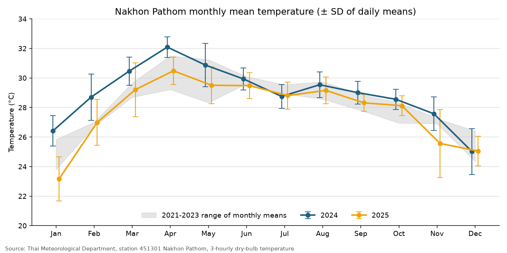
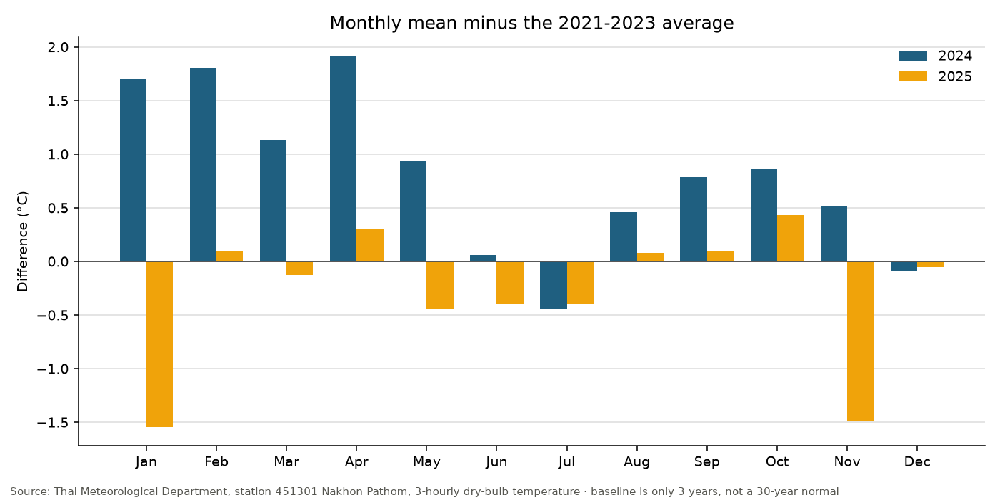
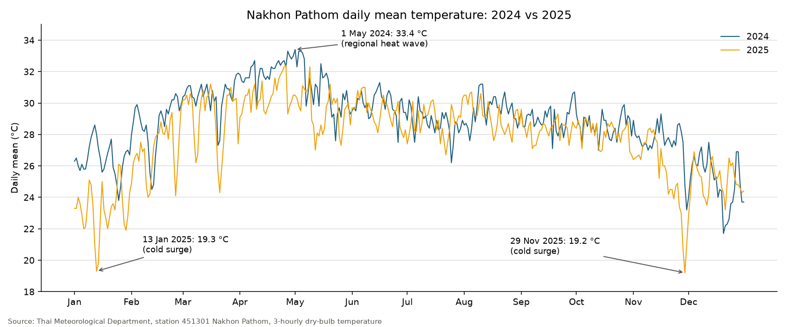

# Was 2024 unusually hot? Nakhon Pathom temperature, 2024 vs 2025

Five years of 3-hourly temperature readings (14,606 readings over 1,826 days) from the Thai Meteorological Department's Nakhon Pathom station, cleaned and compared month by month.

Part of a university physics group project (Silpakorn University, 2026): each member analysed one station; this repository is my station, Nakhon Pathom (451301).

**Tools:** Python (pandas, NumPy, SciPy, matplotlib)

## Answer

**Yes. 2024 was warmer than every year of 2021–2023 in 7 of 12 months; 2025 was not warmer than all three years in any month.**

| | 2021–2023 | 2024 | 2025 |
|---|---|---|---|
| Annual mean | 28.11 °C | **28.90 °C** | 27.82 °C |
| Hottest day | | 1 May: 33.4 °C | 26 Apr: 32.4 °C |
| Coolest day | | 20 Dec: 21.7 °C | 29 Nov: 19.2 °C |





This matches what TMD reported nationally: a "mild winter" in January–February 2024 ([Jan](https://www.tmd.go.th/en/climate/summarymonthly/012024), [Feb](https://www.tmd.go.th/en/climate/summarymonthly/022024)), a national April 2024 mean 2.6 °C above normal ([April 2024 report](https://www.tmd.go.th/media/climate/climate-monthly/april_2024_rev1-0.pdf)), and 2025 being close to the 30-year normal and cooler than 2024 ([2025 annual summary](https://www.tmd.go.th/climate/summaryyearly/2025)).

## Method

1. **Parse** TMD's web-page exports (`.mhtml`, Thai `cp874` encoding) into a tidy table — `prepare_data.py`.
2. **Validate** before analysing: one row per day with no gaps from 2021-01-01 to 2025-12-31; TMD's daily average equals the mean of the 8 readings within 0.05 °C; the export that stops part-way through 30 Aug 2024 is replaced by a second export for Aug–Dec 2024. One day (2023-06-01) has 2 missing readings; TMD's own daily average is kept.
3. **Compare** each month of 2024 and 2025 with the range of the same month in 2021, 2022 and 2023 — `analysis.py`. "Unusually hot" means above all three earlier years.
4. **Test** 2024 vs 2025 per month with Welch's t-test. Daily temperatures are autocorrelated (a hot day is usually followed by a hot day), so the naive test overstates certainty. The adjusted p-value shrinks the sample size by the lag-1 autocorrelation: after the adjustment only January, April and September stay below 0.05.

All monthly figures were re-computed by a second, independently written script during the project and matched in every cell; this cleaned version reproduces them exactly.

## Limitations

- The baseline is 3 years, not TMD's 30-year normal, and 2021–2022 were La Niña years. Anomalies show direction, not exact size.
- Two years apart says "this year was hotter than that year", not a long-term trend.
- A daily mean of 8 readings is not TMD's usual (Tmax + Tmin) / 2, and the 3-hourly maximum is not the true daily maximum.
- Error bars are the SD of daily means (day-to-day spread), not a confidence interval; overlapping bars do not mean the two means are equal.

## Run it

```bash
pip install -r requirements.txt
python analysis.py        # uses the committed data/nakhon_pathom_451301_daily.csv
```

To rebuild the CSV from source, request 3-hourly dry-bulb temperature for station 451301 from the [TMD climate data service](https://www.tmd.go.th/), save the result pages as `.mhtml` into `raw/`, then run `python prepare_data.py`.

## Data

Thai Meteorological Department (กรมอุตุนิยมวิทยา), station 451301 Nakhon Pathom, 3-hourly dry-bulb temperature, 2021–2025. `data/` holds the cleaned daily table derived from it.
